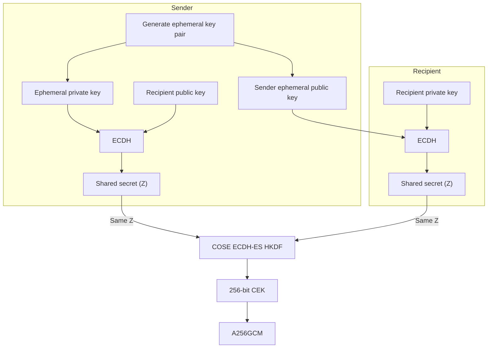

# Person-to-Person Encrypted Message Profile

Document version ID: 20261025

Profile ID: TBD

> [!IMPORTANT]
> 
> This profile intentionally omits the COSE `kid` header parameter.
>
> Key selection is performed using application-level identity and transport metadata rather than identifiers carried within the COSE objects themselves.
>
> For example:
>
> * The sender signing key is determined from the account that published the message.
> * The recipient decryption key is determined from the transport-level recipient identifier.
>
> Implementations MUST NOT assume that a `kid` is present in either `COSE_Sign1` or `COSE_Encrypt`.


# Step 1: Load the Sender Static Private Key and Recipient Static Public Key

Before any signing or encryption occurs, the implementation must load:

* The sender's static P-256 private key.
* The recipient's static P-256 public key.

```
Sender:
    static private key
        ↓
    COSE_Sign1

Recipient:
    static public key
        ↓
    ECDH-ES key agreement
```

The sender private key is used only for signing.

The recipient public key is used later during ECDH-ES encryption to derive shared key material.

The implementation SHOULD accept either:

* COSE_Key
* JWK

and convert the result into the crypto provider's internal key representation.

---

## 1.1 Sender Static Private Key (COSE_Key)

```cbor
{
  1: 2,      / kty = EC2 /
  3: -9,     / alg = ESP256 /
  -1: 1,     / crv = P-256 /

  -2: h'65ed...',
      / public x coordinate
         exactly 32 bytes
         unsigned big-endian integer
         commonly called X
         safe to disclose /

  -3: h'1e52...',
      / public y coordinate
         exactly 32 bytes
         unsigned big-endian integer
         commonly called Y
         safe to disclose /

  -4: h'519b...'
      / private scalar
         exactly 32 bytes
         unsigned big-endian integer
         commonly called d
         secret exponent
         MUST remain confidential /
}
```

### Field Summary

| Label | Meaning |
|---------|---------|
| 1 | Key Type (EC2) |
| 3 | Algorithm (ESP256) |
| -1 | Curve (P-256) |
| -2 | Public X Coordinate |
| -3 | Public Y Coordinate |
| -4 | Private Scalar (d) |

---

## 1.2 Sender Static Private Key (JWK)

```json
{
  "kty": "EC",
  "crv": "P-256",
  "alg": "ES256",
  "x": "Ze2lo...",
  "y": "HlLtd...",
  "d": "UZtCP..."
}
```

### Name Mapping

| COSE | JWK | Common Name |
|------|------|------|
| -2 | x | X Coordinate |
| -3 | y | Y Coordinate |
| -4 | d | Private Scalar |
| -1 | crv | Curve |
| 1 | kty | Key Type |

---

## 1.3 Recipient Static Public Key (COSE_Key)

```cbor
{
  1: 2,     / kty = EC2 /
  -1: 1,    / crv = P-256 /

  -2: h'8d7d...',
      / public x coordinate
         exactly 32 bytes
         unsigned big-endian integer
         commonly called X
         safe to disclose /

  -3: h'29df...'
      / public y coordinate
         exactly 32 bytes
         unsigned big-endian integer
         commonly called Y
         safe to disclose /
}
```

The `-4` member MUST NOT be present in a public key.

---

## 1.4 Recipient Static Public Key (JWK)

```json
{
  "kty": "EC",
  "crv": "P-256",
  "x": "jX2PT...",
  "y": "Kd9Ia..."
}
```

Required members:

```json
{
  "kty": "EC",
  "crv": "P-256",
  "x": "...",
  "y": "..."
}
```

---

## 1.5 Validation Rules

### Sender Private Key

```
kty == EC2 (COSE)
or
kty == EC (JWK)

curve == P-256

x present
y present
d present
```

### Recipient Public Key

```
kty == EC2 (COSE)
or
kty == EC (JWK)

curve == P-256

x present
y present

d absent
```

Reject:

```
P-384
P-521
Ed25519
X25519
RSA
```

for this profile.

---

## 1.6 Length Requirements

For P-256:

```
x = exactly 32 bytes
y = exactly 32 bytes
d = exactly 32 bytes
```

All values are:

```
unsigned integers
big-endian
fixed width (32 octets)
```

If a value exceeds 32 bytes:

```
reject the key
```

---

## 1.7 Output of Step 1

At the end of this step:

```
senderPrivateKey
recipientPublicKey
```

have been successfully loaded, validated, and converted into the implementation's internal key representation.

No signing, hashing, ECDH, HKDF, nonce generation, or encryption has occurred yet.

# Step 2: Create a COSE_Sign1 Signature

At this point the implementation has:

```
senderPrivateKey
recipientPublicKey
payloadBytes
```

where:

```
payloadBytes = CBOR.encode(payloadObject)
```

The structure of `payloadObject` is application-defined and is outside the scope of this step.

COSE treats `payloadBytes` as an opaque byte string and does not interpret its contents.

The purpose of this step is to produce a complete `COSE_Sign1` object which will later become the plaintext input to the encryption step.

```
CBOR Payload
      ↓
COSE_Sign1
      ↓
Signed CBOR Object
      ↓
Step 3: Encryption
```

---

## 2.1 Construct the Protected Header

For this profile the protected header contains the signature algorithm.

CBOR-EDN:

```cbor
{
  1: -9
     / alg = ESP256 /
}
```

The protected header MUST be CBOR encoded and then stored as a byte string.

Human-readable CBOR-EDN notation:

```cbor
<< {
     1: -9
        / alg = ESP256 /
   } >>
```

Meaning:

```
CBOR-encode the header map
then place the resulting bytes
inside a CBOR byte string
```

---

## 2.2 Construct the Unprotected Header

The unprotected header is optional.

For this profile:

```cbor
{}
```

Future versions may include a key identifier (`kid`):

```cbor
{
  4: h'01234567'
      / kid
         key identifier
         identifies sender key /
}
```

For now, the unprotected header remains empty:

```cbor
{}
```

---

## 2.3 Construct the Sig_structure

COSE does not sign the payload directly.

Instead, it constructs a `Sig_structure`, then signs the CBOR encoding of that structure.

CBOR-EDN:

```cbor
[
  "Signature1",

  << {
       1: -9
          / alg = ESP256 /
     } >>,

  h''
      / external_aad
         zero-length byte string /,

  payloadBytes
      / CBOR-encoded application payload /
]
```

Field meanings:

| Position | Value | Purpose |
|-----------|-----------|-----------|
| 0 | `"Signature1"` | Context string |
| 1 | Protected header | Cryptographically bound to the signature |
| 2 | External AAD | Additional authenticated data |
| 3 | Payload | CBOR payload bytes |

---

## 2.4 External AAD

For this profile:

```cbor
h''
```

Meaning:

```
zero-length byte string

length = 0 bytes
```

No external authenticated data is used.

If future protocol versions need authenticated metadata that is not placed inside the payload, it would be supplied here.

---

## 2.5 CBOR Encode the Sig_structure

CBOR encode the entire Sig_structure.

Conceptually:

```
toBeSigned =
    CBOR.encode(
        Sig_structure
    )
```

Result:

```
toBeSigned
```

The exact length depends on the size of the payload.

---

## 2.6 Generate the Signature

Inputs:

```
Private Key:
    senderPrivateKey

Algorithm:
    ESP256

Hash:
    SHA-256

Input:
    toBeSigned
```

Conceptually:

```
ECDSA-P256-SHA256(
    senderPrivateKey,
    toBeSigned
)
```

The ECDSA operation produces two integers:

```
r
s
```

These are the standard ECDSA signature values.

---

## 2.7 Encode the Signature for COSE

For P-256:

```
r = exactly 32 bytes
s = exactly 32 bytes
```

Each value MUST be encoded as:

```
unsigned integer
big-endian
fixed width
```

If necessary, the value MUST be left-padded with zero bytes to reach 32 bytes.

The COSE signature is the concatenation of the encoded `r` value followed by the encoded `s` value:

```
signature = r followed by s
```

Result:

```
32-byte r value
followed by
32-byte s value

64 bytes total
```

CBOR-EDN example:

```cbor
h'
  rrrrrrrrrrrrrrrrrrrrrrrrrrrrrrrrrrrrrrrrrrrrrrrrrrrrrrrrrrrrrrrr
  ssssssssssssssssssssssssssssssssssssssssssssssssssssssssssssssss
'
    / ECDSA signature
       32-byte r value
       followed by
       32-byte s value
       64 bytes total /
```

### Library Compatibility Note

Many cryptographic libraries return ECDSA signatures in ASN.1 DER format:

```
SEQUENCE {
    r INTEGER,
    s INTEGER
}
```

This is not the format used by COSE.

If a cryptographic API returns a DER-encoded signature:

```
DER ECDSA signature
```

the implementation MUST:

1. Decode the ASN.1 structure.
2. Extract the `r` integer.
3. Extract the `s` integer.
4. Convert `r` to a 32-byte unsigned big-endian value.
5. Convert `s` to a 32-byte unsigned big-endian value.
6. Concatenate the bytes:

```
signature =
    r bytes
    followed by
    s bytes
```

The resulting 64-byte value becomes the COSE signature.

---

## 2.8 Construct COSE_Sign1

CBOR-EDN:

```cbor
18([
  << {
       1: -9
          / alg = ESP256 /
     } >>,

  {}
      / unprotected header /,

  payloadBytes
      / CBOR-encoded
         application payload /,

  h'
    rrrrrrrrrrrrrrrrrrrrrrrrrrrrrrrrrrrrrrrrrrrrrrrrrrrrrrrrrrrrrrrr
    ssssssssssssssssssssssssssssssssssssssssssssssssssssssssssssssss
  '
      / ECDSA signature
         64 bytes total
         32-byte r value
         followed by
         32-byte s value /
])
```

Field meanings:

| Position | Value |
|-----------|-----------|
| 0 | Protected Header |
| 1 | Unprotected Header |
| 2 | Payload |
| 3 | Signature |

The `18(...)` wrapper indicates a CBOR tag 18 (`COSE_Sign1`).

---

## 2.9 Output of Step 2

Output:

```
coseSign1
```

represented conceptually as:

```
COSE_Sign1
(
    protected,
    unprotected,
    payload,
    signature
)
```

At this point:

```
integrity      = provided
authenticity   = provided
confidentiality = not yet provided
```

The resulting `COSE_Sign1` object becomes the plaintext input to the encryption step.

# Step 3: Encrypt the COSE_Sign1 Message for a Single Recipient

At this point the implementation has:

```
senderPrivateKey
recipientPublicKey
coseSign1
```

where:

```
coseSign1
```

is the complete signed object produced in Step 2.

The purpose of this step is to encrypt the signed message so that only the intended recipient can decrypt it.

```
COSE_Sign1
      ↓
COSE_Encrypt
      ↓
Encrypted Message
```

Although COSE supports multiple recipients, this profile uses exactly one recipient.

```
recipient count = 1
```

The recipient is the static public key loaded in Step 1.

---

## 3.1 Generate an Ephemeral ECDH Key Pair

Before encryption, generate a new P-256 key pair.

```
ephemeralPrivateKey
ephemeralPublicKey
```

Requirements:

```
curve = P-256

generated using a cryptographically
secure random number generator

generate a new key pair for every message
```

Never reuse an ephemeral private key.

```
GOOD:
    new ephemeral key per message

BAD:
    reuse one ephemeral key for multiple messages
```

The ephemeral key pair provides forward secrecy.

---

## 3.2 Construct the Ephemeral COSE_Key

The recipient must receive the ephemeral public key.

CBOR-EDN:

```cbor
{
  1: 2,      / kty = EC2 /
  -1: 1,     / crv = P-256 /

  -2: h'XXXXXXXXXXXXXXXXXXXXXXXXXXXXXXXXXXXXXXXXXXXXXXXXXXXXXXXXXXXXXXXX',
      / ephemeral public x coordinate
         exactly 32 bytes
         unsigned big-endian integer
         commonly called X /

  -3: h'YYYYYYYYYYYYYYYYYYYYYYYYYYYYYYYYYYYYYYYYYYYYYYYYYYYYYYYYYYYYYYYY'
      / ephemeral public y coordinate
         exactly 32 bytes
         unsigned big-endian integer
         commonly called Y /
}
```

Only the public components are transmitted.

The ephemeral private key MUST remain secret.

---

## 3.3 Perform ECDH Key Agreement

Inputs:

```
sender:
    ephemeralPrivateKey

recipient:
    recipientPublicKey
```

Conceptually:

```
sharedSecret =
    ECDH(
        ephemeralPrivateKey,
        recipientPublicKey
    )
```

Result:

```
sharedSecret
```

For P-256:

```
length = 32 bytes
length = 256 bits
```

The shared secret is not used directly as an encryption key.

---

## 3.4 Derive the Content Encryption Key (CEK)

This profile uses:

```
ECDH-ES
```

The shared secret is passed through the COSE ECDH-ES key derivation process to produce the Content Encryption Key (CEK).

Conceptually:

```
CEK =
    ECDH-ES-KDF(
        sharedSecret,
        protectedHeaders
    )
```

See Appendix A for ECDH-ES-KDF.

Result:

```
CEK
```

For this profile:

```
CEK length = 32 bytes
CEK length = 256 bits
```

The CEK is then used with AES-256-GCM.

---

## 3.5 Generate an Initialization Vector (IV)

Generate a random IV.

Requirements:

```
length = 12 bytes
length = 96 bits

generated using a cryptographically
secure random number generator
```

Example:

```cbor
h'112233445566778899aabbcc'
    / IV
       12 bytes
       96 bits /
```

Generate a new IV for every encryption operation.

Never reuse an IV with the same CEK.

---

## 3.6 Construct the Protected Header

For this profile:

```cbor
<< {
     1: 3
        / alg = A256GCM /
   } >>
```

Meaning:

```
A256GCM
=
AES-256-GCM
```

The protected header will be authenticated by AES-GCM.

---

## 3.7 Construct the Unprotected Header

The unprotected header contains:

* The AES-GCM initialization vector (IV).
* The sender's ephemeral public key.

CBOR-EDN:

```cbor
{
  5: h'112233445566778899aabbcc'
      / IV
         header parameter: IV
         12 bytes
         96 bits
         random value
         public information /,

 -1: {
       1: 2,
          / kty = EC2
             elliptic curve key /,

      -1: 1,
          / crv = P-256
             NIST P-256 curve /,

      -2: h'XXXXXXXXXXXXXXXXXXXXXXXXXXXXXXXXXXXXXXXXXXXXXXXXXXXXXXXXXXXXXXXX',
          / x coordinate
             exactly 32 bytes
             unsigned big-endian integer
             commonly called X /,

      -3: h'YYYYYYYYYYYYYYYYYYYYYYYYYYYYYYYYYYYYYYYYYYYYYYYYYYYYYYYYYYYYYYYY'
          / y coordinate
             exactly 32 bytes
             unsigned big-endian integer
             commonly called Y /
     }
      / ephemeral public key
         header parameter: epk
         sender-generated public key
         recipient uses this key
         during ECDH key agreement /
}
```

For this profile, the sender's ephemeral public key (epk) is carried directly in the COSE_Encrypt unprotected header.

### Field Summary

| Label | Meaning |
|---------|---------|
| 5 | IV (Initialization Vector) |
| -1 (outer) | epk (Ephemeral Public Key) |
| 1 | kty (Key Type) |
| -1 (inside COSE_Key) | crv (Curve) |
| -2 | X Coordinate |
| -3 | Y Coordinate |

### Purpose

The recipient needs both values contained in this header:

```
IV
```

Used by AES-256-GCM during decryption.

```
ephemeral public key
```

Used together with the recipient's private key to reproduce the same ECDH shared secret created by the sender.

The recipient computes:

```
ECDH(
    recipientPrivateKey,
    senderEphemeralPublicKey
)
```

which produces the same shared secret generated by the sender in Step 3.3.

Neither the IV nor the ephemeral public key are secret.

They MUST be transmitted with the encrypted message.

---

## 3.8 Encrypt the COSE_Sign1 Payload

The plaintext is the complete CBOR encoding of the `COSE_Sign1` object.

Conceptually:

```
plaintext =
    CBOR.encode(coseSign1)
```

Inputs:

```
CEK
IV
plaintext
AAD
```

where:

```
AAD =
    protected header bytes
```

Perform:

```
AES-256-GCM(
    key = CEK,
    iv = IV,
    plaintext,
    aad
)
```

Outputs:

```
ciphertext
authentication tag
```

Many crypto libraries return:

```
ciphertext || tag
```

as a single byte string.

Others return:

```
ciphertext
tag
```

separately.

For the document, simply refer to the resulting encrypted bytes as:

```
ciphertext
```

---

## 3.9 Construct COSE_Encrypt

CBOR-EDN:

```cbor
96([
  << {
       1: 3
          / alg = A256GCM /
     } >>,

  {
    5: h'112233445566778899aabbcc'
        / IV
           12 bytes /,

   -1: {
         1: 2,
        -1: 1,

        -2: h'XXXXXXXXXXXXXXXXXXXXXXXXXXXXXXXXXXXXXXXXXXXXXXXXXXXXXXXXXXXXXXXX',
        -3: h'YYYYYYYYYYYYYYYYYYYYYYYYYYYYYYYYYYYYYYYYYYYYYYYYYYYYYYYYYYYYYYYY'
       }
        / ephemeral public key /
  },

  h'CCCCCCCCCCCCCCCCCCCCCCCCCCCCCCCCCCCCCCCCCCCCCCCCCCCCCCCC'
      / encrypted COSE_Sign1
         includes AES-GCM authentication tag /
])
```

Field meanings:

| Position | Value |
|-----------|-----------|
| 0 | Protected Header |
| 1 | Unprotected Header |
| 2 | Ciphertext |

The `96(...)` wrapper indicates a CBOR tag 96 (`COSE_Encrypt`).

Although there is only a single recipient, this profile continues to use `COSE_Encrypt` rather than `COSE_Encrypt0` so that future multi-recipient support can be introduced with minimal structural changes.

---

## 3.10 Output of Step 3

Output:

```
coseEncrypt
```

represented conceptually as:

```
COSE_Encrypt
(
    protected,
    unprotected,
    ciphertext
)
```

At this point:

```
integrity        = provided
authenticity     = provided
confidentiality  = provided
```

The resulting `COSE_Encrypt` object is the final message produced by the sender and can be transmitted to the recipient.

---

### Size Overhead Estimate

For the profile defined in this document:

```
COSE_Sign1
ESP256
ECDH-ES
P-256
AES-256-GCM
single recipient
```

the cryptographic protection layers add approximately:

| Component | Approximate Size |
|------------|------------------|
| COSE_Sign1 framing | ~10 bytes |
| ECDSA signature (r + s) | 64 bytes |
| COSE_Encrypt framing | ~15 bytes |
| AES-GCM IV | 12 bytes |
| AES-GCM authentication tag | 16 bytes |
| Ephemeral public key (P-256) | ~75 bytes |
| **Total Overhead** | **~180-200 bytes** |

Rule of thumb:

```
final_message_size
    ≈
payload_size
    +
190 bytes
```

The exact size depends on:

* CBOR encoding of the payload.
* Optional header parameters.
* Encoding lengths as CBOR structures grow.

# Step 4: Decrypt the COSE_Encrypt Message

At this point the recipient has:

```
recipientPrivateKey
receivedBytes
```

where:

```
receivedBytes
```

is the serialized `COSE_Encrypt` message produced by Step 3.

The purpose of this step is to:

1. Validate the COSE_Encrypt structure.
2. Recover the ECDH shared secret.
3. Derive the Content Encryption Key (CEK).
4. Decrypt the ciphertext.
5. Recover the embedded `COSE_Sign1` object.

```
COSE_Encrypt
      ↓
AES-GCM Decrypt
      ↓
COSE_Sign1
```

---

## 4.1 Decode the Top-Level CBOR Object

Decode:

```
receivedBytes
```

as CBOR.

Expected structure:

```cbor
96([
  protected,
  unprotected,
  ciphertext
])
```

Validation:

* Top-level object MUST exist.
* Top-level object MUST be tagged.
* Tag MUST be 96 (COSE_Encrypt).

---

## 4.2 Validate the COSE_Encrypt Array

Expected structure:

```cbor
96([
  protected,
  unprotected,
  ciphertext
])
```

Field meanings:

| Position | Value |
|-----------|-----------|
| 0 | Protected Header |
| 1 | Unprotected Header |
| 2 | Ciphertext |

Validation:

* Object MUST be an array.
* Array length MUST be exactly 3.

---

## 4.3 Validate the Protected Header

Expected:

```cbor
<< {
     1: 3
   } >>
```

Meaning:

```
alg = A256GCM
```

Validation:

* Protected header MUST be a CBOR byte string.
* Protected header MUST decode into a CBOR map.
* Header parameter 1 MUST exist.
* Header parameter 1 MUST equal 3.
* Unsupported algorithms MUST be rejected.
* Implementations MUST NOT silently substitute alternative encryption algorithms.


---

## 4.4 Validate the Unprotected Header

The unprotected header must contain:

```
IV
ephemeral public key
```

Expected:

```cbor
{
  5: iv,
 -1: epk
}
```

Validation:

* Unprotected header MUST be a CBOR map.
* Header parameter 5 MUST exist.
* Header parameter -1 MUST exist.

---

## 4.5 Validate the IV

Header parameter:

```cbor
5: iv
```

Validation:

* IV MUST be a byte string.
* IV MUST be exactly 12 bytes.

Purpose: AES-256-GCM initialization vector

---

## 4.6 Validate the Ephemeral Public Key

Header parameter:

```cbor
-1: {
      1: 2,
     -1: 1,
     -2: x,
     -3: y
    }
```

Expected:

```
kty = EC2
crv = P-256
```

Validation:

* `epk` MUST be a CBOR map.
* `kty` MUST equal EC2.
* `crv` MUST equal P-256.
* `x` coordinate MUST exist.
* `y` coordinate MUST exist.
* `x` length MUST equal 32 bytes.
* `y` length MUST equal 32 bytes.

---

## 4.7 Extract the Ciphertext

Expected:

```cbor
ciphertext
```

Validation:

* Ciphertext MUST be a byte string.
* Ciphertext MUST NOT be empty.

---

## 4.8 Reconstruct the Sender's Ephemeral Public Key

Convert:

```
epk
```

into the implementation's internal public key representation.

Inputs:

```
curve = P-256

x coordinate

y coordinate
```

Result:

```
senderEphemeralPublicKey
```

---

## 4.9 Perform ECDH Key Agreement

Inputs:

```
recipientPrivateKey

senderEphemeralPublicKey
```

Perform:

```
ECDH(
    recipientPrivateKey,
    senderEphemeralPublicKey
)
```

Result:

```
sharedSecret
```

Length:

```
32 bytes
256 bits
```

Failure:

```
ECDH failure
    → REJECT
```

---

## 4.10 Derive the Content Encryption Key (CEK)

Using the same ECDH-ES key derivation process used by the sender:

```
CEK =
    ECDH-ES-KDF(
        sharedSecret,
        protectedHeader
    )
```

See Appendix A for ECDH-ES-KDF.

Result:

```
CEK
```

Length:

```
32 bytes
256 bits
```

---

## 4.11 Decrypt the Ciphertext

Inputs:

```
CEK

IV

ciphertext

AAD =
    protected header bytes
```

Perform:

```
AES-256-GCM Decrypt
```

Result:

```
plaintext
```

Expected plaintext:

```
CBOR encoding of a COSE_Sign1 object
```

Reject:

```
authentication tag failure
decryption failure
invalid ciphertext
invalid CEK
```

Any AES-GCM authentication failure:

```
→ REJECT
```

No partial plaintext should be processed.

The implementation MUST successfully verify the AES-GCM authentication tag before releasing the plaintext.

If authentication fails, the message MUST be rejected and the decrypted bytes MUST NOT be processed.

---

## 4.12 Decode the Plaintext

Decode:

```
plaintext
```

as CBOR.

Expected:

```cbor
18([
  protected,
  unprotected,
  payload,
  signature
])
```

Validation:

* Decoded object MUST exist.
* Decoded object MUST be tagged.
* Tag MUST equal 18 (COSE_Sign1).

At this stage:

```
confidentiality
    = verified

authenticity
    = not yet verified

integrity
    = not yet verified
```

The signature still needs to be validated.

---

## 4.13 Output of Step 4

Output:

```
coseSign1
```

represented as:

```cbor
18([
  protected,
  unprotected,
  payload,
  signature
])
```

The output of this step becomes the input to Step 5.

```
Step 4 Output:
    decrypted COSE_Sign1

Step 5 Input:
    verify COSE_Sign1 signature
```

# Step 5: Validate the COSE_Sign1 Signature

At this point the implementation has:

```
coseSign1
```

from Step 4 and has already established:

```
confidentiality = verified
```

The purpose of this step is to:

1. Validate the structure of the decrypted `COSE_Sign1`.
2. Resolve the sender's signing public key.
3. Reconstruct the original `Sig_structure`.
4. Verify the ECDSA signature.
5. Recover the authenticated payload.

```
COSE_Sign1
      ↓
Signature Verification
      ↓
Authenticated Payload
```

---

> [!IMPORTANT]
> This profile does not include the COSE `kid` (Key Identifier)
> header parameter.
>
> Sender key selection is performed using application-level identity
> and transport metadata rather than identifiers carried within the
> COSE object itself.
>
> For example:
>
> * The account that published the message determines which signing
>   public key should be used.
> * A profile document or account metadata may contain the sender's
>   current signing key.
>
> Implementations MUST NOT assume that a `kid` is present in the
> `COSE_Sign1` object.

---

## 5.1 Validate the COSE_Sign1 Structure

Expected structure:

```cbor
18([
  protected,
  unprotected,
  payload,
  signature
])
```

Validation:

* Object MUST exist.
* Object MUST be tagged.
* Tag MUST equal 18 (COSE_Sign1).
* Expected array length: 4

---

## 5.2 Validate the Protected Header

Expected:

```cbor
<< {
     1: -9
   } >>
```

Meaning:

```
alg = ESP256
```

Validation:

* Protected header MUST be a byte string.
* Protected header MUST decode into a CBOR map.
* Header parameter 1 MUST exist.
* Header parameter 1 MUST equal -9.

---

## 5.3 Validate the Unprotected Header

Expected:

```cbor
{}
```

Validation:

* Unprotected header MUST be a CBOR map.

This profile does not currently require any unprotected header parameters.

Unknown parameters MAY be ignored unless restricted by the implementation.

---

## 5.4 Validate the Payload

Expected:

```
CBOR payload bytes
```

Validation:

* Payload MUST be a byte string.
* Payload MUST NOT be null.
* Payload MUST NOT be empty.

The payload itself remains opaque at this stage.

Its internal structure is application-defined.

---

## 5.5 Validate the Signature

Expected:

```
r || s
```

Validation:

* Signature MUST be a byte string.
* Signature length MUST equal 64 bytes.

For P-256:

```
r = first 32 bytes
s = last 32 bytes
```

Reject:

* Signature is not a byte string
* Signature length != 64 bytes

---

## 5.6 Resolve the Sender's Public Key

Using application-level identity information:

```
sender account
sender profile
sender identity document
transport metadata
```

locate:

```
senderPublicKey
```

Expected characteristics:

```
kty = EC2
crv = P-256
```

Reject:

* unable to determine sender
* sender public key unavailable
* unsupported key type
* unsupported curve

---

## 5.7 Reconstruct the Sig_structure

The verifier MUST reconstruct the same structure signed by the sender.

CBOR-EDN:

```cbor
[
  "Signature1",

  << {
       1: -9
          / alg = ESP256 /
     } >>,

  h''
      / external_aad
         zero-length byte string /,

  payload
]
```

Validation:

* external_aad MUST be empty
* for this profile.

---

## 5.8 Encode the Sig_structure

CBOR encode the structure.

Conceptually:

```
toBeVerified =
    CBOR.encode(
        Sig_structure
    )
```

This MUST produce exactly the same bytes used by the signer.

---

## 5.9 Convert the Signature for the Crypto API

The COSE signature format is:

```
r || s
```

Many crypto APIs expect: ASN.1 DER

If necessary:

* extract r
* extract s
* construct: SEQUENCE { r INTEGER, s INTEGER }

Result:

```
signatureForCryptoAPI
```

This step is implementation-specific.

---

## 5.10 Verify the Signature

Inputs:

```
senderPublicKey

toBeVerified

signature
```

Perform:

```
ECDSA-P256-SHA256 Verify
```

Conceptually:

```
verify(
    senderPublicKey,
    toBeVerified,
    signature
)
```

Result:

```
true
or
false
```

Reject:

```
verification failure
```

Any failed signature verification:

```
→ REJECT
```

The payload MUST NOT be processed further.

---

## 5.11 Decode the Payload

After successful verification:

```
payload
```

contains:

```
CBOR.encode(payloadObject)
```

Decode:

```
payloadObject =
    CBOR.decode(payload)
```

Reject:

```
invalid CBOR payload

payload decode failure
```

---

## 5.12 Output of Step 5

Output:

```
payloadObject
```

At this point:

```
confidentiality = verified

integrity = verified

authenticity = verified
```

The message has been:

```
decrypted
verified
authenticated
accepted
```

The resulting application payload may now be processed by the microblogging application.

---

# Appendix A: ECDH-ES Key Derivation Process

## A.1 Overview

This profile uses COSE ECDH-ES key agreement to derive a content encryption key (CEK) for use with **A256GCM**.

A fresh ephemeral key pair is generated for every encrypted message. The sender performs an ECDH operation using:

- the sender's ephemeral private key, and
- the recipient's long-term public key.

The resulting shared secret is processed through the COSE/HKDF key derivation procedure to produce a 256-bit CEK suitable for A256GCM.

No key identifiers (`kid`) are used in this profile.

## A.2 Key Agreement Flow

The sender and recipient independently derive the same content encryption key (CEK).

The sender generates a fresh ephemeral key pair for each encrypted message. The recipient uses its long-term key pair.



At the sender:

```text
Z = ECDH(
      sender_ephemeral_private,
      recipient_static_public
    )
```

At the recipient:

```text
Z = ECDH(
      recipient_static_private,
      sender_ephemeral_public
    )
```

The sender transmits the ephemeral public key in the `epk` header parameter. The recipient extracts this value and uses it to perform ECDH.

Because both parties derive the same ECDH shared secret and use the same HKDF context, they derive an identical 256-bit content encryption key (CEK).

---

## A.3 Sender Ephemeral Public Key

The sender SHALL generate a new ephemeral key pair for every encrypted message.

The ephemeral public key SHALL be included in the recipient's unprotected header using the `epk` parameter.

Example:

```cbor-diag
{
  -1: {
    1: 2,
    -1: 1,
    -2: h'...',
    -3: h'...'
  }
}
```

Where:

| Label | Meaning |
|---------|---------|
| `1: 2` | EC2 key type |
| `-1: 1` | P-256 curve |
| `-2` | X coordinate |
| `-3` | Y coordinate |

---

## A.4 Shared Secret Computation

The ECDH shared secret SHALL be computed as:

```text
Z = ECDH(
      sender_ephemeral_private,
      recipient_static_public
    )
```

The resulting value `Z` becomes the input keying material for HKDF.

---

## A.5 HKDF Context

This profile uses the COSE ECDH-ES HKDF context structure.

Only the algorithm identifier and key length are included.

No PartyUInfo fields are used.

No PartyVInfo fields are used.

The context therefore consists of:

```text
COSE_KDF_Context = [
    AlgorithmID,
    PartyUInfo,
    PartyVInfo,
    SuppPubInfo,
    SuppPrivInfo
]
```

with the following values:

```text
AlgorithmID  = "A256GCM"
PartyUInfo   = empty
PartyVInfo   = empty
SuppPubInfo  = KeyDataLength(256)
SuppPrivInfo = empty
```

---

## A.6 Context in CBOR-EDN

The complete KDF context is represented as:

```cbor-diag
[
  3,
  [null, null, null],
  [null, null, null],
  [256, h'']
]
```

where:

| Element | Value |
|----------|--------|
| AlgorithmID | `3`: A256GCM |
| PartyUInfo | empty |
| PartyVInfo | empty |
| KeyDataLength | `256` |
| Protected Data | absent |
| SuppPrivInfo | absent |

---

### A.7 HKDF Parameters and CEK Derivation

HKDF transforms the raw ECDH shared secret into the 256-bit Content
Encryption Key (CEK) used by A256GCM.

The HKDF operation SHALL use the following parameters:

```text
Hash Function : SHA-256
Salt          : h''
IKM           : Z
Info          : deterministic CBOR encoding of COSE_KDF_Context
Output Length : 32 bytes
```

The parameters have the following meanings.

**Hash Function**

SHA-256 is the hash function used by both the extract and expand
operations of HKDF.

```text
Hash = SHA-256
```

**Salt**

The salt is an optional, non-secret input to the HKDF extract
operation.

This profile does not transmit or otherwise define a salt value.
Implementations SHALL therefore use a zero-length byte string:

```cbor-diag
h''
```

Conceptually:

```text
Salt = empty byte string
```

If an HKDF API permits the salt parameter to be omitted and defines
omission according to HKDF, omission may be used instead. If the API
requires an explicit value, the implementation SHALL supply a
zero-length byte string.

The HKDF salt is separate from:

- the A256GCM initialization vector;
- the COSE KDF context;
- PartyUInfo and PartyVInfo; and
- the sender's ephemeral public key.

The A256GCM initialization vector MUST NOT be used as the HKDF salt.

**IKM**

IKM means *Input Keying Material*.

For this profile, the IKM is the raw ECDH shared secret, denoted by
`Z`:

```text
IKM = Z
```

The sender computes:

```text
Z = ECDH(
      sender_ephemeral_private,
      recipient_static_public
    )
```

The recipient computes:

```text
Z = ECDH(
      recipient_static_private,
      sender_ephemeral_public
    )
```

Both computations produce the same value. For P-256, `Z` is the
32-byte ECDH shared secret produced by the cryptographic provider.

`Z` MUST NOT be used directly as an A256GCM key.

**Info**

`Info` is the context supplied to the HKDF expand operation. It binds
the derived key to the algorithm and output-key size selected by this
profile.

`Info` SHALL be the CBOR encoding of the following
`COSE_KDF_Context`:

```cbor-diag
[
  3,
  [null, null, null],
  [null, null, null],
  [256, h'']
]
```

The fields are:

```text
AlgorithmID          = 3
PartyUInfo           = [null, null, null]
PartyVInfo           = [null, null, null]
SuppPubInfo          = [256, h'']
SuppPrivInfo         = omitted
```

Their meanings are:

- `3` is the registered COSE algorithm identifier for A256GCM.
- The three `null` values in `PartyUInfo` indicate that no sender
  identity, nonce, or other party information is supplied.
- The three `null` values in `PartyVInfo` indicate that no recipient
  identity, nonce, or other party information is supplied.
- `256` is `keyDataLength`, expressed in bits.
- `h''` is the required `protected` member of `SuppPubInfo`. It is an
  empty byte string because this profile supplies no protected
  recipient-level attributes to the KDF.
- The optional `other` member of `SuppPubInfo` is omitted.
- The optional `SuppPrivInfo` element is omitted.

The algorithm identifier MUST be encoded as the integer `3`. It MUST
NOT be encoded as the text string `"A256GCM"`.

The `protected` member in `SuppPubInfo` MUST be encoded as the empty
byte string `h''`. It MUST NOT be encoded as `null`.

Optional elements that are absent MUST be omitted. Implementations
MUST NOT append `null` values for the optional `other` or
`SuppPrivInfo` fields.

Both sender and recipient MUST construct and encode exactly the same
context. Any difference in its CBOR encoding produces different HKDF
input and therefore a different CEK.

Conceptually:

```text
context = [
    3,
    [null, null, null],
    [null, null, null],
    [256, h'']
]

info = CBOR.encode(context)
```

**Output Length**

The requested HKDF output length is 32 bytes:

```text
L = 32
```

This is required because:

```text
A256GCM
=
AES-256-GCM
=
256-bit key
=
32-byte key
```

The complete derivation is:

```text
CEK = HKDF-SHA256(
          Salt = h'',
          IKM  = Z,
          Info = CBOR.encode([
              3,
              [null, null, null],
              [null, null, null],
              [256, h'']
          ]),
          L    = 32
      )
```

An implementation that exposes the two HKDF stages separately may
express the same operation as:

```text
PRK = HKDF-Extract(
          hash = SHA-256,
          salt = h'',
          IKM  = Z
      )

CEK = HKDF-Expand(
          hash = SHA-256,
          PRK  = PRK,
          info = CBOR.encode(COSE_KDF_Context),
          L    = 32
      )
```

The resulting `CEK` is exactly 32 bytes and SHALL be used directly as
the A256GCM encryption or decryption key.

The intermediate values `Z` and `PRK` are secret key material. They
MUST NOT be transmitted, logged, persisted unnecessarily, or included
in the COSE message.

---

## A.8 Content Encryption

The derived CEK SHALL be used directly as the A256GCM key.

A fresh 96-bit IV SHALL be generated for every encryption operation.

```text
ciphertext = AES-256-GCM(
                 CEK,
                 IV,
                 plaintext,
                 aad
             )
```

---

## A.9 Recipient Processing

Upon receipt of an encrypted message, the recipient SHALL:

1. Extract the sender's ephemeral public key (`epk`).
2. Perform ECDH using:
   - the recipient's private key, and
   - the sender's ephemeral public key.
3. Reconstruct the same COSE KDF context.
4. Run HKDF-SHA256.
5. Obtain the 256-bit CEK.
6. Decrypt the ciphertext using A256GCM.

Because both parties compute the same ECDH shared secret and use the same KDF context, they derive identical CEKs.

---

## A.10 Profile Requirements

This profile imposes the following requirements:

- A new ephemeral key pair SHALL be generated for every encrypted message.
- The ephemeral public key SHALL be transmitted using `epk`.
- No `kid` values are used.
- PartyUInfo SHALL be empty.
- PartyVInfo SHALL be empty.
- The KDF context SHALL contain only:
  - `AlgorithmID = "A256GCM"`
  - `KeyDataLength = 256`
- HKDF-SHA256 SHALL be used.
- The HKDF output length SHALL be 32 bytes.
- The derived key SHALL be used directly as the A256GCM content encryption key.