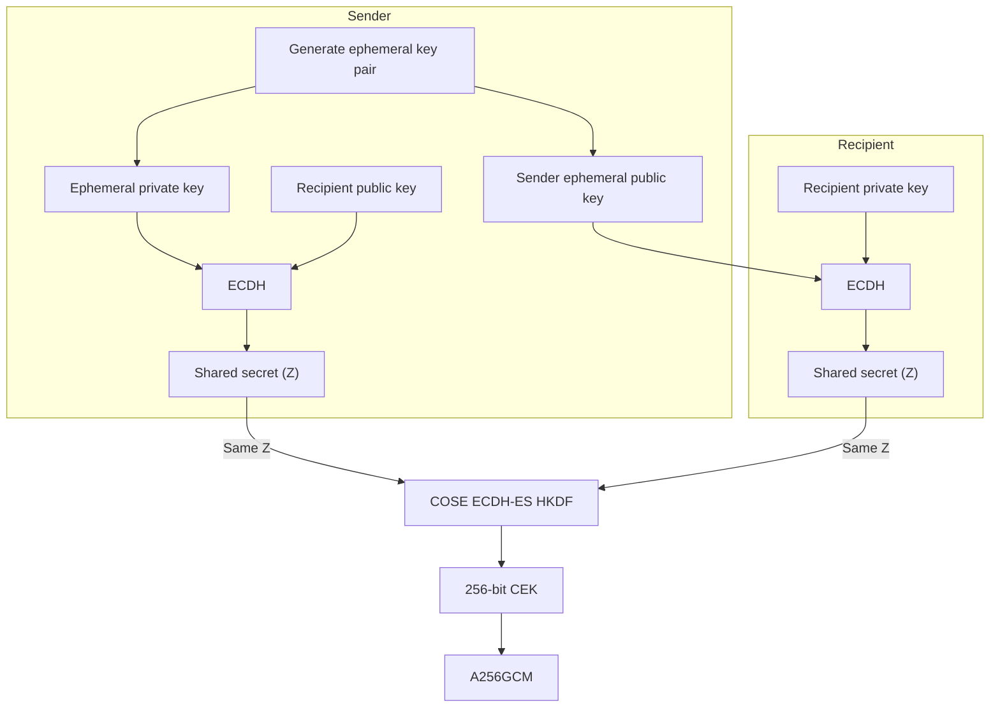

# Single-Recipient Encrypted Message Profile

Document version ID: 20261128

Payload is described in [Encrypted Message Payload](Encrypted%20Message%20Payload.md)

This profile specifies the single-recipient COSE object carried in the `COSE_MB` wrapper defined in [COSE-MB Messages](COSE-MB%20Messages.md). The object MUST have exactly one recipient.

> [!IMPORTANT]
> 
> This profile intentionally omits the COSE `kid` header parameter.
>
> Key selection is performed using application-level identity and transport metadata rather than identifiers carried within the COSE objects themselves.
>
> For example:
>
> * The sender signing key is determined from the account that published the message.
> * The recipient decryption key is determined from the transport-level recipient identifier.
>
> Implementations MUST NOT assume that a `kid` is present in either `COSE_Sign1` or `COSE_Encrypt`.

## Common Encoding and Validation Requirements

The COSE structures and processing follow RFC 9052, the ECDH and HKDF algorithms follow RFC 9053, and ESP256 is defined by RFC 9864.

Implementations MUST reject duplicate labels in every CBOR map, including key, protected-header, unprotected-header, and application-payload maps. A decoder that silently overwrites duplicate labels is not sufficient.

This profile also rejects a header label appearing in both the protected and unprotected buckets of the same layer. Unknown critical header parameters MUST cause rejection; unknown non-critical parameters MAY be ignored.

The `Sig_structure`, `Enc_structure`, and `COSE_KDF_Context` MUST use deterministic CBOR encoding with definite lengths and shortest argument encodings. Cryptographic computations MUST use the original protected-header byte strings received on the wire, not a decoded and re-encoded header map.


# Step 1: Load the Sender Static Private Key and Recipient Static Public Key

Before any signing or encryption occurs, the implementation must load:

* The sender's static P-256 private key.
* The recipient's static P-256 public key.

In this sending operation, the sender static private key is used only for signing. ECDH uses a fresh sender ephemeral private key.

The recipient public key is used later during ECDH-ES encryption to derive shared key material.

Each account uses one reusable static P-256 key pair: its private key signs outgoing messages and performs ECDH when receiving messages; its public key verifies signatures and is used by others when encrypting to that account.

Stored static COSE_Key and JWK representations MUST omit `alg`. Algorithms are selected in the appropriate COSE message headers: ESP256 (`-9`) for signatures and ECDH-ES+HKDF-256 (`-25`) for recipient key agreement. A signing-only `alg` value MUST NOT be silently ignored to permit ECDH use. Existing algorithm-restricted keys require explicit conversion to the algorithm-neutral representation before they can serve both roles.

This profile does not require `key_ops` or JWK `use` in stored static keys. The crypto provider's key objects MUST be imported with only the usages needed for the current operation.

Implementations MUST accept COSE_Key for static keys and MAY also accept JWK. Convert supported key inputs into the crypto provider's internal key representation.

---

## 1.1 Sender Static Private Key (COSE_Key)

```cbor-diag
{
  1: 2,      / kty = EC2 /
  -1: 1,     / crv = P-256 /

  -2: h'65ed...',
      / public x coordinate
         exactly 32 bytes
         unsigned big-endian integer
         commonly called X
         safe to disclose /

  -3: h'1e52...',
      / public y coordinate
         exactly 32 bytes
         unsigned big-endian integer
         commonly called Y
         safe to disclose /

  -4: h'519b...'
      / private scalar
         exactly 32 bytes
         unsigned big-endian integer
         commonly called d
         secret exponent
         MUST remain confidential /
}
```

### Field Summary

| Label | Meaning |
|---------|---------|
| 1 | Key Type (EC2) |
| -1 | Curve (P-256) |
| -2 | Public X Coordinate |
| -3 | Public Y Coordinate |
| -4 | Private Scalar (d) |

---

## 1.2 Sender Static Private Key (JWK)

```json
{
  "kty": "EC",
  "crv": "P-256",
  "x": "Ze2lo...",
  "y": "HlLtd...",
  "d": "UZtCP..."
}
```

### Name Mapping

| COSE | JWK | Common Name |
|------|------|------|
| -2 | x | X Coordinate |
| -3 | y | Y Coordinate |
| -4 | d | Private Scalar |
| -1 | crv | Curve |
| 1 | kty | Key Type |

---

## 1.3 Recipient Static Public Key (COSE_Key)

```cbor-diag
{
  1: 2,     / kty = EC2 /
  -1: 1,    / crv = P-256 /

  -2: h'8d7d...',
      / public x coordinate
         exactly 32 bytes
         unsigned big-endian integer
         commonly called X
         safe to disclose /

  -3: h'29df...'
      / public y coordinate
         exactly 32 bytes
         unsigned big-endian integer
         commonly called Y
         safe to disclose /
}
```

The `-4` member MUST NOT be present in a public key.

---

## 1.4 Recipient Static Public Key (JWK)

```json
{
  "kty": "EC",
  "crv": "P-256",
  "x": "jX2PT...",
  "y": "Kd9Ia..."
}
```

Required members:

```json
{
  "kty": "EC",
  "crv": "P-256",
  "x": "...",
  "y": "..."
}
```

---

## 1.5 Validation Rules

Validate the sender private key and recipient public key as follows:

* **Key type:** In COSE_Key, the `kty` label is the CBOR integer `1`, and the value MUST be the CBOR integer `2` (EC2). In JWK, if supported, `kty` MUST be the JSON string `"EC"`.
* **Curve:** `crv` MUST identify P-256.
* **Algorithm:** `alg` MUST be absent.
* **Public coordinates:** Both `x` and `y` MUST be present, including in private keys.
* **Private scalar:** The `-4` member in COSE_Key or `d` member in JWK MUST be present in a private key and MUST NOT be present in a public key.

Reject other curves and key types, including:

* P-384
* P-521
* Ed25519
* X25519
* RSA

The same validation rules apply to the recipient static private key used for decryption and the sender static public key used for signature verification.

All public keys MUST represent a finite point Q on P-256. Both coordinates MUST be in the curve's field and satisfy its curve equation. Reject the point at infinity and invalid points; coordinate lengths alone are not sufficient.

For private keys, the scalar d MUST satisfy `1 <= d < n`, where n is the P-256 subgroup order. The supplied public point MUST equal `d * G`, where G is the P-256 generator. A key import operation that checks only types and lengths does not satisfy these validation requirements.

---

## 1.6 Length Requirements

For P-256, each of `x`, `y`, and `d`, when present, MUST be an unsigned big-endian integer encoded in exactly 32 bytes. Reject keys with shorter or longer values.

COSE values MUST be byte strings. JWK values MUST decode from base64url to the same fixed-width byte strings. Compressed-point representations are not accepted by this profile.

---

## 1.7 Output of Step 1

At the end of this step, `senderPrivateKey` and `recipientPublicKey` have been loaded, validated, and converted into the implementation's internal key representation.

No signing, hashing, ECDH, HKDF, nonce generation, or encryption has occurred yet.

# Step 2: Create a COSE_Sign1 Signature

The implementation has `senderPrivateKey`, `recipientPublicKey`, and `payloadBytes`, where `payloadBytes = CBOR.encode(payloadObject)`.

The structure of `payloadObject` is defined in [Encrypted Message Payload](Encrypted%20Message%20Payload.md).

COSE treats `payloadBytes` as an opaque byte string and does not interpret its contents.

1. Construct and sign the `Sig_structure` for the CBOR payload.
2. Assemble the signed `COSE_Sign1` object.
3. Pass the CBOR encoding of that object to Step 3 as the plaintext to encrypt.

---

## 2.1 Construct the Protected Header

For this profile the protected header contains the signature algorithm.

CBOR-EDN:

```cbor-diag
{
  1: -9
     / alg = ESP256 /
}
```

The protected header MUST be CBOR encoded and then stored as a byte string.

Human-readable CBOR-EDN notation:

```cbor-diag
<< {
     1: -9
        / alg = ESP256 /
   } >>
```

---

## 2.2 Construct the Unprotected Header

The unprotected header is optional.

For this profile, use an empty map (`{}`).

Future versions may include a key identifier (`kid`):

```cbor-diag
{
  4: h'01234567'
      / kid
         key identifier
         identifies sender key /
}
```

---

## 2.3 Construct the Sig_structure

COSE does not sign the payload directly.

Instead, it constructs a `Sig_structure`, then signs the CBOR encoding of that structure.

CBOR-EDN:

```cbor-diag
[
  "Signature1",

  << {
       1: -9
          / alg = ESP256 /
     } >>,

  h''
      / external_aad
         zero-length byte string /,

  payloadBytes
      / CBOR-encoded application payload /
]
```

Field meanings:

| Position | Value | Purpose |
|-----------|-----------|-----------|
| 0 | `"Signature1"` | Context string |
| 1 | Protected header | Cryptographically bound to the signature |
| 2 | External AAD | Additional authenticated data |
| 3 | Payload | CBOR payload bytes |

---

## 2.4 External AAD

No external authenticated data is used. Set `external_aad` to the zero-length byte string `h''`.

If future protocol versions need authenticated metadata that is not placed inside the payload, it would be supplied here.

---

## 2.5 CBOR Encode the Sig_structure

CBOR-encode the entire `Sig_structure` to produce `toBeSigned`. Its length depends on the size of the payload.

---

## 2.6 Generate the Signature

Sign `toBeSigned` with `senderPrivateKey` using ESP256 (ECDSA with P-256 and SHA-256). The operation produces the two ECDSA signature integers, `r` and `s`.

---

## 2.7 Encode the Signature for COSE

For P-256, `r` and `s` MUST each be encoded as unsigned big-endian integers of exactly 32 bytes, left-padded with zero bytes if necessary. Concatenate `r` followed by `s` to produce the 64-byte COSE signature.

CBOR-EDN example:

```cbor-diag
h'
  rrrrrrrrrrrrrrrrrrrrrrrrrrrrrrrrrrrrrrrrrrrrrrrrrrrrrrrrrrrrrrrr
  ssssssssssssssssssssssssssssssssssssssssssssssssssssssssssssssss
'
    / ECDSA signature
       32-byte r value
       followed by
       32-byte s value
       64 bytes total /
```

### Library Compatibility Note

Many cryptographic libraries return ECDSA signatures in ASN.1 DER format:

```
SEQUENCE {
    r INTEGER,
    s INTEGER
}
```

This is not the format used by COSE.

If a cryptographic API returns a DER-encoded signature, the implementation MUST:

1. Decode the ASN.1 structure.
2. Extract the `r` integer.
3. Extract the `s` integer.
4. Convert `r` to a 32-byte unsigned big-endian value.
5. Convert `s` to a 32-byte unsigned big-endian value.
6. Concatenate the encoded `r` followed by the encoded `s`.

The resulting 64-byte value becomes the COSE signature.

---

## 2.8 Construct COSE_Sign1

CBOR-EDN:

```cbor-diag
18([
  << {
       1: -9
          / alg = ESP256 /
     } >>,

  {}
      / unprotected header /,

  payloadBytes
      / CBOR-encoded
         application payload /,

  h'
    rrrrrrrrrrrrrrrrrrrrrrrrrrrrrrrrrrrrrrrrrrrrrrrrrrrrrrrrrrrrrrrr
    ssssssssssssssssssssssssssssssssssssssssssssssssssssssssssssssss
  '
      / ECDSA signature
         64 bytes total
         32-byte r value
         followed by
         32-byte s value /
])
```

Field meanings:

| Position | Value |
|-----------|-----------|
| 0 | Protected Header |
| 1 | Unprotected Header |
| 2 | Payload |
| 3 | Signature |

The `18(...)` wrapper indicates a CBOR tag 18 (`COSE_Sign1`).

---

## 2.9 Output of Step 2

The output, `coseSign1`, is the `COSE_Sign1` object constructed in Step 2.8. The signature provides integrity and authenticity, but not confidentiality. The object's CBOR encoding becomes the plaintext input to Step 3.

# Step 3: Encrypt the COSE_Sign1 Message for a Single Recipient

The implementation starts with `coseSign1`, the complete signed object produced in Step 2, and `recipientPublicKey`, the static public key loaded in Step 1.

1. Generate an ephemeral key pair, derive the content encryption key, and generate an IV.
2. Encrypt the CBOR encoding of `coseSign1`.
3. Assemble the `COSE_Encrypt` object with exactly one recipient.

---

## 3.1 Generate an Ephemeral ECDH Key Pair

Before encrypting each message, generate a new P-256 key pair (`ephemeralPrivateKey` and `ephemeralPublicKey`) using a cryptographically secure random number generator.

Fresh ephemeral keys provide fresh per-message shared secrets, but this ephemeral-static scheme does not provide forward secrecy against compromise of the recipient's static private key. An attacker holding that key can recompute shared secrets for recorded messages using their transmitted ephemeral public keys. The ephemeral private key MUST NOT be persisted or reused.

---

## 3.2 Construct the Ephemeral COSE_Key

The recipient must receive the ephemeral public key.

CBOR-EDN:

```cbor-diag
{
  1: 2,      / kty = EC2 /
  -1: 1,     / crv = P-256 /

  -2: h'XXXXXXXXXXXXXXXXXXXXXXXXXXXXXXXXXXXXXXXXXXXXXXXXXXXXXXXXXXXXXXXX',
      / ephemeral public x coordinate
         exactly 32 bytes
         unsigned big-endian integer
         commonly called X /

  -3: h'YYYYYYYYYYYYYYYYYYYYYYYYYYYYYYYYYYYYYYYYYYYYYYYYYYYYYYYYYYYYYYYY'
      / ephemeral public y coordinate
         exactly 32 bytes
         unsigned big-endian integer
         commonly called Y /
}
```

Only the public components are transmitted.

The ephemeral COSE_Key MUST NOT contain `-4` or an `alg` member and MUST satisfy the public-point validation requirements in Step 1.

The ephemeral private key MUST remain secret.

---

## 3.3 Perform ECDH Key Agreement

Compute `sharedSecret = ECDH(ephemeralPrivateKey, recipientPublicKey)`. For P-256, the result is 32 bytes (256 bits). Do not use the shared secret directly as an encryption key.

---

## 3.4 Derive the Content Encryption Key (CEK)

Use ECDH-ES+HKDF-256 (COSE algorithm `-25`) to derive the content encryption key (CEK).

Conceptually:

```
CEK =
    ECDH-ES-KDF(
        sharedSecret,
        recipientProtected
    )
```

Here `recipientProtected = h''`. The KDF's protected data is the recipient protected-header byte string, not the COSE_Encrypt content protected header. The complete context is fixed by Appendix A.

The resulting CEK is 32 bytes (256 bits) and is used with AES-256-GCM.

---

## 3.5 Generate an Initialization Vector (IV)

Generate a 12-byte (96-bit) IV using a cryptographically secure random number generator.

Example:

```cbor-diag
h'112233445566778899aabbcc'
    / IV
       12 bytes
       96 bits /
```

Generate a new IV for every encryption operation.

Never reuse an IV with the same CEK.

---

## 3.6 Construct the Protected Header

For this profile:

```cbor-diag
<< {
     1: 3
        / alg = A256GCM /
   } >>
```

`A256GCM` denotes AES-256-GCM, which authenticates the protected header.

---

## 3.7 Construct the Unprotected Header

The COSE_Encrypt content unprotected header contains only the IV:

```cbor-diag
{
  5: h'112233445566778899aabbcc'
      / IV: 12 bytes, generated randomly for this message /
}
```

The ephemeral public key belongs to a separate COSE_recipient structure. For this profile the recipient protected header is the zero-length byte string `h''`. The recipient unprotected header contains the key agreement algorithm and the sender's ephemeral public key:

CBOR-EDN:

```cbor-diag
{
  1: -25
      / alg = ECDH-ES+HKDF-256 /,

 -1: {
       1: 2,
          / kty = EC2
             elliptic curve key /,

      -1: 1,
          / crv = P-256
             NIST P-256 curve /,

      -2: h'XXXXXXXXXXXXXXXXXXXXXXXXXXXXXXXXXXXXXXXXXXXXXXXXXXXXXXXXXXXXXXXX',
          / x coordinate
             exactly 32 bytes
             unsigned big-endian integer
             commonly called X /,

      -3: h'YYYYYYYYYYYYYYYYYYYYYYYYYYYYYYYYYYYYYYYYYYYYYYYYYYYYYYYYYYYYYYYY'
          / y coordinate
             exactly 32 bytes
             unsigned big-endian integer
             commonly called Y /
     }
      / ephemeral public key
         header parameter: epk
         sender-generated public key
         recipient uses this key
         during ECDH key agreement /
}
```

The single COSE_recipient is:

```cbor-diag
[
  h'',                         / recipient protected header /
  { 1: -25, -1: epk },         / recipient unprotected header /
  h''                          / no encrypted key: CEK is derived directly /
]
```

The `epk` name above denotes the ephemeral COSE_Key map. It is not an additional wire field. The recipient ciphertext is empty because this profile uses direct key agreement, not key wrapping. Nested recipients are absent.

### Field Summary

| Label | Meaning |
|---------|---------|
| 5 (content header) | IV (Initialization Vector) |
| 1 (recipient header) | Algorithm (ECDH-ES+HKDF-256) |
| -1 (recipient header) | epk (Ephemeral Public Key) |
| 1 (inside COSE_Key) | kty (Key Type) |
| -1 (inside COSE_Key) | crv (Curve) |
| -2 | X Coordinate |
| -3 | Y Coordinate |

### Purpose

* The IV in the content unprotected header is used for AES-256-GCM decryption.
* The sender's ephemeral public key in the recipient unprotected header is used with the recipient's private key to reproduce the ECDH shared secret from Step 3.3.

Neither value is secret. Both MUST be transmitted with the encrypted message.

---

## 3.8 Encrypt the COSE_Sign1 Payload

The plaintext is `CBOR.encode(coseSign1)`. Encrypt it with the CEK, IV, and the following AAD:

```
AAD =
    CBOR.encode([
        "Encrypt",
        protectedHeaderBytes,
        h''
    ])
```

This is the COSE `Enc_structure`, using the original COSE_Encrypt protected header bytes and an empty `external_aad`. The content protected header bytes alone MUST NOT be used as AAD.

Perform:

```
AES-256-GCM(
    key = CEK,
    iv = IV,
    plaintext,
    aad
)
```

Crypto libraries may return the encrypted bytes and authentication tag separately or as a single byte string. For A256GCM the tag MUST be 16 bytes (128 bits). The serialized COSE ciphertext MUST contain the encrypted bytes followed by the tag (`encryptedBytes || authenticationTag`).

---

## 3.9 Construct COSE_Encrypt

CBOR-EDN:

```cbor-diag
96([
  << {
       1: 3
          / alg = A256GCM /
     } >>,

  {
    5: h'112233445566778899aabbcc'
        / IV
           12 bytes /
  },

  h'CCCCCCCCCCCCCCCCCCCCCCCCCCCCCCCCCCCCCCCCCCCCCCCCCCCCCCCC'
      / encrypted COSE_Sign1
         includes 16-byte AES-GCM authentication tag /,

  [
    [
      h''
          / recipient protected header /,
      {
        1: -25,
            / alg = ECDH-ES+HKDF-256 /
        -1: {
              1: 2,
             -1: 1,
             -2: h'XXXXXXXXXXXXXXXXXXXXXXXXXXXXXXXXXXXXXXXXXXXXXXXXXXXXXXXXXXXXXXXX',
             -3: h'YYYYYYYYYYYYYYYYYYYYYYYYYYYYYYYYYYYYYYYYYYYYYYYYYYYYYYYYYYYYYYYY'
            }
            / epk: ephemeral public key only /
      },
      h''
          / no encrypted key /
    ]
  ]
      / recipients array: exactly one COSE_recipient /
])
```

Field meanings:

| Position | Value |
|-----------|-----------|
| 0 | Protected Header |
| 1 | Unprotected Header |
| 2 | Ciphertext |
| 3 | Recipients (exactly one) |

The `96(...)` wrapper indicates a CBOR tag 96 (`COSE_Encrypt`).

This profile uses COSE_Encrypt because it carries explicit ECDH recipient information, even though only one recipient is permitted.

---

## 3.10 Output of Step 3

The output, `coseEncrypt`, is the `COSE_Encrypt` object from Step 3.9. The signature and encryption together provide integrity, authenticity, and confidentiality. This object is ready to be placed in the `COSE_MB` wrapper for transmission.

---

### Size Overhead Estimate

The cryptographic protection layers for one recipient add approximately:

| Component | Approximate Size |
|------------|------------------|
| COSE_Sign1 framing | ~10 bytes |
| ECDSA signature (r + s) | 64 bytes |
| COSE_Encrypt framing | ~15 bytes |
| AES-GCM IV | 12 bytes |
| AES-GCM authentication tag | 16 bytes |
| Ephemeral public key (P-256) | ~75 bytes |
| **Total Overhead** | **~180-200 bytes** |

As a rule of thumb, the result is about 190 bytes larger than the payload.

The exact size depends on:

* CBOR encoding of the payload.
* Optional header parameters.
* Encoding lengths as CBOR structures grow.

# Step 4: Decrypt the COSE_Encrypt Message

The recipient starts with `recipientPrivateKey` and `receivedBytes`, the serialized `COSE_Encrypt` object produced by Step 3.

The purpose of this step is to:

1. Validate the COSE_Encrypt structure.
2. Recover the ECDH shared secret.
3. Derive the Content Encryption Key (CEK).
4. Decrypt the ciphertext.
5. Recover the embedded `COSE_Sign1` object.

---

## 4.1 Decode the Top-Level CBOR Object

Decode `receivedBytes` as CBOR.

Expected structure:

```cbor-diag
96([
  protected,
  unprotected,
  ciphertext,
  recipients
])
```

Validation:

* Top-level object MUST exist.
* Top-level object MUST be tagged.
* Tag MUST be 96 (COSE_Encrypt).
* Duplicate CBOR map labels MUST be rejected throughout decoding.

---

## 4.2 Validate the COSE_Encrypt Array

Expected structure:

```cbor-diag
96([
  protected,
  unprotected,
  ciphertext,
  recipients
])
```

Field meanings:

| Position | Value |
|-----------|-----------|
| 0 | Protected Header |
| 1 | Unprotected Header |
| 2 | Ciphertext |
| 3 | Recipients (exactly one) |

Validation:

* Object MUST be an array.
* Array length MUST be exactly 4.
* Recipients MUST be an array containing exactly one COSE_recipient.
* That COSE_recipient MUST be an array of exactly 3 elements.
* Its protected header MUST be the zero-length byte string `h''`.
* Its unprotected header MUST be a CBOR map.
* Its header parameter `1` MUST equal -25 (ECDH-ES+HKDF-256).
* Its header parameter -1 MUST contain the ephemeral public COSE_Key.
* Its ciphertext MUST be the zero-length byte string `h''`.
* Nested recipients and additional recipients MUST be rejected.

---

## 4.3 Validate the Protected Header

Expected:

```cbor-diag
<< {
     1: 3
   } >>
```

Validation:

* Protected header MUST be a CBOR byte string.
* Protected header MUST decode into a CBOR map.
* Header parameter `1` MUST exist.
* Header parameter `1` MUST equal `3` (A256GCM).
* Unsupported algorithms MUST be rejected.
* Implementations MUST NOT silently substitute alternative encryption algorithms.


---

## 4.4 Validate the Unprotected Header

The `COSE_Encrypt` content unprotected header contains the IV:

```cbor-diag
{
  5: iv
}
```

Validation:

* Unprotected header MUST be a CBOR map.
* Header parameter 5 MUST exist.

The ephemeral public key is obtained from the single recipient's unprotected header, not from the content header. See Steps 4.2 and 4.6.

---

## 4.5 Validate the IV

Header parameter `5`, the AES-256-GCM IV, MUST be a byte string of exactly 12 bytes.

---

## 4.6 Validate the Ephemeral Public Key

Header parameter -1 in the single recipient's unprotected header:

```cbor-diag
-1: {
      1: 2,
     -1: 1,
     -2: x,
     -3: y
    }
```

Validation:

* `epk` MUST be a CBOR map.
* `kty` MUST be the CBOR integer `2` (EC2).
* `crv` MUST equal P-256.
* `x` coordinate MUST exist.
* `y` coordinate MUST exist.
* `x` and `y` MUST be byte strings.
* `x` length MUST equal 32 bytes.
* `y` length MUST equal 32 bytes.
* `-4` (private scalar) MUST NOT be present.
* `alg` MUST NOT be present.
* The coordinates MUST represent a finite, valid P-256 point as specified
  in Step 1.

---

## 4.7 Extract the Ciphertext

* Ciphertext MUST be a byte string.
* Ciphertext MUST NOT be empty.
* Ciphertext MUST include a 16-byte AES-GCM authentication tag.

---

## 4.8 Reconstruct the Sender's Ephemeral Public Key

Convert `epk` to the implementation's internal public key representation using its P-256 curve and `x` and `y` coordinates. The result is `senderEphemeralPublicKey`.

---

## 4.9 Perform ECDH Key Agreement

Compute `sharedSecret = ECDH(recipientPrivateKey, senderEphemeralPublicKey)`. The result is 32 bytes (256 bits). Reject the message if ECDH fails.

---

## 4.10 Derive the Content Encryption Key (CEK)

Using the same ECDH-ES key derivation process used by the sender:

```
CEK =
    ECDH-ES-KDF(
        sharedSecret,
        recipientProtected
    )
```

See Appendix A for ECDH-ES-KDF. Here `recipientProtected = h''`, as validated in Step 4.2. The content protected header is used in the `Enc_structure`, not in the recipient KDF context. The resulting CEK is 32 bytes (256 bits).

---

## 4.11 Decrypt the Ciphertext

Decrypt `ciphertext` with AES-256-GCM using the CEK, the IV, and the following AAD:

```
AAD =
    CBOR.encode([
        "Encrypt",
        protectedHeaderBytes,
        h''
    ])
```

Use the original content protected-header byte string and an empty `external_aad`, exactly as in Step 3.8. The last 16 bytes of the serialized ciphertext are the AES-GCM authentication tag.

The plaintext is expected to be the CBOR encoding of a `COSE_Sign1` object. Reject the message if the ciphertext or CEK is invalid, decryption fails, or the authentication tag fails verification.

The implementation MUST successfully verify the AES-GCM authentication tag before releasing the plaintext.

If authentication fails, the message MUST be rejected and the decrypted bytes MUST NOT be processed.

---

## 4.12 Decode the Plaintext

Decode `plaintext` as CBOR.

Expected:

```cbor-diag
18([
  protected,
  unprotected,
  payload,
  signature
])
```

Validation:

* Decoded object MUST exist.
* Decoded object MUST be tagged.
* Tag MUST equal 18 (COSE_Sign1).

At this stage, decryption has succeeded, but the signature still needs to be verified to establish the sender's authenticity and the integrity of the signed payload.

---

## 4.13 Output of Step 4

Pass the decoded `coseSign1` object from Step 4.12 to Step 5 for signature verification.

# Step 5: Validate the COSE_Sign1 Signature

After successful authenticated decryption in Step 4, use the resulting `coseSign1` object to:

1. Validate the structure of the decrypted `COSE_Sign1`.
2. Resolve the sender's signing public key.
3. Reconstruct the original `Sig_structure`.
4. Verify the ECDSA signature.
5. Recover the authenticated payload.

---

## 5.1 Validate the COSE_Sign1 Structure

Expected structure:

```cbor-diag
18([
  protected,
  unprotected,
  payload,
  signature
])
```

Validation:

* Object MUST exist.
* Object MUST be tagged.
* Tag MUST equal 18 (COSE_Sign1).
* Expected array length: 4

---

## 5.2 Validate the Protected Header

Expected:

```cbor-diag
<< {
     1: -9
   } >>
```

Validation:

* Protected header MUST be a byte string.
* Protected header MUST decode into a CBOR map.
* Header parameter `1` MUST exist.
* Header parameter `1` MUST equal `-9` (ESP256).

---

## 5.3 Validate the Unprotected Header

The unprotected header MUST be a CBOR map. This profile does not require any unprotected header parameters, so the map may be empty (`{}`).

Unknown parameters MAY be ignored unless restricted by the implementation.

---

## 5.4 Validate the Payload

The payload MUST be a non-empty byte string containing the CBOR payload bytes. It MUST NOT be `null`.

The payload is defined in [Encrypted Message Payload](Encrypted%20Message%20Payload.md).

---

## 5.5 Validate the Signature

The signature MUST be a 64-byte byte string in `r || s` order: the first 32 bytes encode `r`, and the last 32 bytes encode `s`. Reject the message if the signature has the wrong type or length.

---

## 5.6 Resolve the Sender's Public Key

Resolve `senderPublicKey` using application-level identity information or transport metadata, as described in the introduction. For example, look up the publishing account's key in its profile or identity document.

The sender public key MUST satisfy the static public key validation rules in Step 1.

Reject:

* unable to determine sender
* sender public key unavailable
* unsupported key type
* unsupported curve

---

## 5.7 Reconstruct the Sig_structure

The verifier MUST reconstruct the same structure signed by the sender.

CBOR-EDN:

```cbor-diag
[
  "Signature1",

  << {
       1: -9
          / alg = ESP256 /
     } >>,

  h''
      / external_aad
         zero-length byte string /,

  payload
]
```

The `external_aad` MUST be empty for this profile.

---

## 5.8 Encode the Sig_structure

CBOR-encode the `Sig_structure` to produce `toBeVerified`. This MUST produce exactly the same bytes used by the signer.

---

## 5.9 Convert the Signature for the Crypto API

COSE uses `r || s`, but some crypto APIs expect ASN.1 DER. If the API requires DER, extract `r` and `s` and encode them as `SEQUENCE { r INTEGER, s INTEGER }`.

---

## 5.10 Verify the Signature

Use `senderPublicKey` to verify the signature over `toBeVerified` using ECDSA with P-256 and SHA-256. If verification fails, reject the message. The payload MUST NOT be processed further.

---

## 5.11 Decode the Payload

After successful signature verification, decode `payload` from CBOR to recover `payloadObject`. Reject the message if the payload is invalid CBOR or decoding fails.

---

## 5.12 Output of Step 5

Once decryption and signature verification succeed and the payload decodes, the application may process the resulting `payloadObject`.

---

# Appendix A: ECDH-ES Key Derivation Process

## A.1 Overview

This profile uses COSE ECDH-ES key agreement to derive a content encryption key (CEK) for use with **A256GCM**.

A fresh ephemeral key pair is generated for every encrypted message. The sender performs an ECDH operation using:

- the sender's ephemeral private key, and
- the recipient's long-term public key.

The resulting shared secret is processed through the COSE/HKDF key derivation procedure to produce a 256-bit CEK suitable for A256GCM.

## A.2 Key Agreement Flow

The sender and recipient independently derive the same content encryption key (CEK).

The sender generates a fresh ephemeral key pair for each encrypted message. The recipient uses its long-term key pair.



At the sender:

```
Z = ECDH(
      sender_ephemeral_private,
      recipient_static_public
    )
```

At the recipient:

```
Z = ECDH(
      recipient_static_private,
      sender_ephemeral_public
    )
```

The sender transmits the ephemeral public key in the `epk` header parameter. The recipient extracts this value and uses it to perform ECDH.

Because both parties derive the same ECDH shared secret and use the same HKDF context, they derive an identical 256-bit content encryption key (CEK).

---

## A.3 Sender Ephemeral Public Key

The sender SHALL generate a new ephemeral key pair for every encrypted message.

The ephemeral public key SHALL be included in the recipient's unprotected header using the `epk` parameter.

The same recipient unprotected header SHALL include `alg: -25` (ECDH-ES+HKDF-256). Its protected header SHALL be `h''`, and its ciphertext SHALL be `h''` because no key is wrapped or transported.

Example:

```cbor-diag
{
  1: -25,
  -1: {
    1: 2,
    -1: 1,
    -2: h'...',
    -3: h'...'
  }
}
```

Where:

| Label | Meaning |
|---------|---------|
| `1: 2` | EC2 key type |
| `-1: 1` | P-256 curve |
| `-2` | X coordinate |
| `-3` | Y coordinate |

---

## A.4 Shared Secret Computation

The ECDH shared secret SHALL be computed as:

```
Z = ECDH(
      sender_ephemeral_private,
      recipient_static_public
    )
```

The resulting value `Z` becomes the input keying material for HKDF.

---

## A.5 HKDF Context

This profile uses the COSE ECDH-ES HKDF context structure.

The context includes the content encryption algorithm identifier, the two required party-information arrays, and SuppPubInfo. The party-information fields are null because this profile supplies no party identities or nonces. SuppPubInfo contains the key length and the required empty recipient protected-header byte string. Optional fields are omitted.

The context therefore consists of:

```
COSE_KDF_Context = [
    AlgorithmID,
    PartyUInfo,
    PartyVInfo,
    SuppPubInfo
]
```

The field values are shown in Appendix A.6.

---

## A.6 Context in CBOR-EDN

The complete KDF context is represented as:

```cbor-diag
[
  3,
  [null, null, null],
  [null, null, null],
  [256, h'']
]
```

where:

| Element | Value |
|----------|--------|
| AlgorithmID | `3`: A256GCM |
| PartyUInfo | `[null, null, null]` |
| PartyVInfo | `[null, null, null]` |
| KeyDataLength | `256` |
| Protected Data | `h''` (empty recipient protected header) |
| SuppPrivInfo | absent |

---

### A.7 HKDF Parameters and CEK Derivation

HKDF transforms the raw ECDH shared secret into the 256-bit Content Encryption Key (CEK) used by A256GCM.

The HKDF operation SHALL use the following parameters:

| Parameter | Value |
|-----------|-------|
| Hash function | SHA-256 |
| Salt | `h''` |
| IKM | `Z` |
| Info | Deterministic CBOR encoding of `COSE_KDF_Context` |
| Output length | 32 bytes |

The parameters have the following meanings.

**Hash Function**

SHA-256 is the hash function used by both the extract and expand operations of HKDF.

**Salt**

The salt is an optional, non-secret input to the HKDF extract operation.

This profile does not transmit or otherwise define a salt value. Implementations SHALL therefore use the zero-length byte string `h''`.

If an HKDF API permits the salt parameter to be omitted and defines omission according to HKDF, omission may be used instead. If the API requires an explicit value, the implementation SHALL supply a zero-length byte string.

The HKDF salt is separate from:

- the A256GCM initialization vector;
- the COSE KDF context;
- PartyUInfo and PartyVInfo; and
- the sender's ephemeral public key.

The A256GCM initialization vector MUST NOT be used as the HKDF salt.

**IKM**

IKM means *Input Keying Material*.

For this profile, the IKM is the raw ECDH shared secret, denoted by `Z`.

The sender computes:

```
Z = ECDH(
      sender_ephemeral_private,
      recipient_static_public
    )
```

The recipient computes:

```
Z = ECDH(
      recipient_static_private,
      sender_ephemeral_public
    )
```

Both computations produce the same value. For P-256, `Z` is the 32-byte ECDH shared secret produced by the cryptographic provider.

`Z` MUST NOT be used directly as an A256GCM key.

**Info**

`Info` is the context supplied to the HKDF expand operation. It binds the derived key to the algorithm and output-key size selected by this profile.

`Info` SHALL be the CBOR encoding of the following `COSE_KDF_Context`:

```cbor-diag
[
  3,
  [null, null, null],
  [null, null, null],
  [256, h'']
]
```

The field values and their meanings are:

- `3` is the registered COSE algorithm identifier for A256GCM.
- The three `null` values in `PartyUInfo` indicate that no sender
  identity, nonce, or other party information is supplied.
- The three `null` values in `PartyVInfo` indicate that no recipient
  identity, nonce, or other party information is supplied.
- `256` is `keyDataLength`, expressed in bits.
- `h''` is the required `protected` member of `SuppPubInfo`. It is an
  empty byte string because the recipient protected header is `h''`.
  The recipient algorithm (`-25`) and `epk` are in its unprotected header.
  The content protected header (`<< {1: 3} >>`) is not used in this field.
- The optional `other` member of `SuppPubInfo` is omitted.
- The optional `SuppPrivInfo` element is omitted.

The algorithm identifier MUST be encoded as the integer `3`. It MUST NOT be encoded as the text string `"A256GCM"`.

The `protected` member in `SuppPubInfo` MUST be encoded as the empty byte string `h''`. It MUST NOT be encoded as `null`.

Optional elements that are absent MUST be omitted. Implementations MUST NOT append `null` values for the optional `other` or `SuppPrivInfo` fields.

Both sender and recipient MUST construct and encode exactly the same context. Any difference in its CBOR encoding produces different HKDF input and therefore a different CEK.

Conceptually:

```
context = [
    3,
    [null, null, null],
    [null, null, null],
    [256, h'']
]

info = CBOR.encode(context)
```

**Output Length**

Set `L` to 32 bytes because A256GCM requires a 256-bit key.

The complete derivation is:

```
CEK = HKDF-SHA256(
          Salt = h'',
          IKM  = Z,
          Info = CBOR.encode([
              3,
              [null, null, null],
              [null, null, null],
              [256, h'']
          ]),
          L    = 32
      )
```

An implementation that exposes the two HKDF stages separately may express the same operation as:

```
PRK = HKDF-Extract(
          hash = SHA-256,
          salt = h'',
          IKM  = Z
      )

CEK = HKDF-Expand(
          hash = SHA-256,
          PRK  = PRK,
          info = CBOR.encode(COSE_KDF_Context),
          L    = 32
      )
```

The resulting `CEK` is exactly 32 bytes and SHALL be used directly as the A256GCM encryption or decryption key.

The intermediate values `Z` and `PRK` are secret key material. They MUST NOT be transmitted, logged, persisted unnecessarily, or included in the COSE message.

---

## A.8 Content Encryption

The derived CEK SHALL be used directly as the A256GCM key.

A fresh 96-bit IV SHALL be generated for every encryption operation.

The authentication tag SHALL be 128 bits. The AAD SHALL be the deterministic CBOR encoding of `["Encrypt", contentProtectedBytes, h'']`, using the original content protected-header bytes and empty external AAD.

```
ciphertext = AES-256-GCM(
                 CEK,
                 IV,
                 plaintext,
                 aad
             )
```

---

## A.9 Recipient Processing

Upon receipt of an encrypted message, the recipient SHALL:

1. Validate the single recipient and its ECDH-ES+HKDF-256 (`-25`) algorithm;
   extract the sender's ephemeral public key (`epk`) from its unprotected header.
2. Perform ECDH using:
   - the recipient's private key, and
   - the sender's ephemeral public key.
3. Reconstruct the same COSE KDF context.
4. Run HKDF-SHA256.
5. Obtain the 256-bit CEK.
6. Decrypt the ciphertext using A256GCM and the Enc_structure AAD defined
   in Step 4.11; then verify the embedded COSE_Sign1 before releasing its payload.

Because both parties compute the same ECDH shared secret and use the same KDF context, they derive identical CEKs.

---

## A.10 Profile Requirements

This profile imposes the following requirements:

- A new ephemeral key pair SHALL be generated for every encrypted message.
- COSE_Encrypt SHALL contain exactly one COSE_recipient.
- The recipient unprotected header SHALL contain `alg: -25` and `epk`.
- The ephemeral public key SHALL NOT contain private key material.
- The recipient protected header and ciphertext SHALL each be `h''`.
- PartyUInfo and PartyVInfo SHALL each be `[null, null, null]`.
- The complete KDF context SHALL be
  `[3, [null, null, null], [null, null, null], [256, h'']]`.
- Optional KDF context elements SHALL be omitted, not encoded as null.
- HKDF-SHA256 SHALL be used.
- The HKDF salt SHALL be `h''`, not the IV.
- The HKDF output length SHALL be 32 bytes.
- The derived key SHALL be used directly as the A256GCM content encryption key.
- A256GCM SHALL use a fresh 12-byte IV and a 16-byte authentication tag.
- AAD SHALL be CBOR encoding of `["Encrypt", contentProtectedBytes, h'']`.